<picture>
  <source media="(prefers-color-scheme: dark)" srcset="./assets/hero-dark.svg">
  
</picture>

  

<a href="https://reposensei.com">
  <picture>
    <source media="(prefers-color-scheme: dark)" srcset="./assets/repo-sensei-dark.svg">
    
  </picture>
</a>

  

It started with [OpenLens](https://openlens-ten.vercel.app), which found you a first open-source issue and the files to touch. OpenLens never read the code. repo-sensei does: it answers questions about a repository with citations to the exact lines, traces features across TypeScript, Python and Java, and plugs into Claude Code, Cursor and VS Code over MCP.

I hold it to a benchmark I built and published. 0.95 hop recall on the repo I tuned it on, 0.23 to 0.33 on repos it has never seen. The second number is the one I'm working on.

**[Try it](https://reposensei.com)** &nbsp;·&nbsp; [Source](https://github.com/K-sau07/repo-sensei) &nbsp;·&nbsp; [CrossLayerBench](https://github.com/K-sau07/crosslayerbench) &nbsp;·&nbsp; [How it's measured](https://reposensei.com/benchmarks)

 

<picture><source media="(prefers-color-scheme: dark)" srcset="./assets/section-running-dark.svg"></picture>

<a href="https://openlens-ten.vercel.app"><picture><source media="(prefers-color-scheme: dark)" srcset="./assets/card-openlens-dark.svg">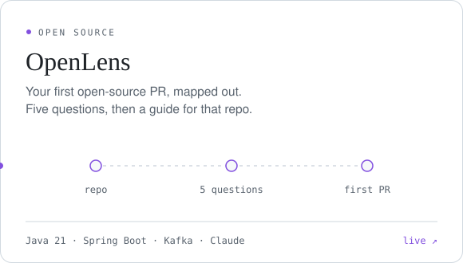</picture></a>
&nbsp;
<a href="https://t-assist.vercel.app"><picture><source media="(prefers-color-scheme: dark)" srcset="./assets/card-tassist-dark.svg">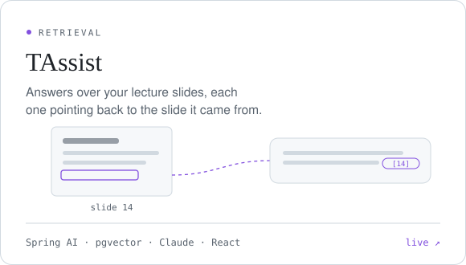</picture></a>

<a href="https://watchdog-sand.vercel.app"><picture><source media="(prefers-color-scheme: dark)" srcset="./assets/card-watchdog-dark.svg"></picture></a>
&nbsp;
<a href="https://ghost-os-pied.vercel.app"><picture><source media="(prefers-color-scheme: dark)" srcset="./assets/card-ghostos-dark.svg">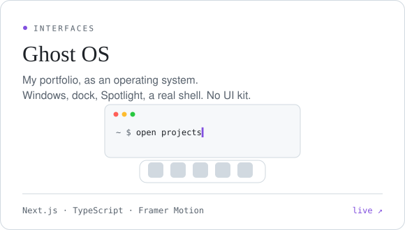</picture></a>

<a href="https://ecoplate-gamma.vercel.app"><picture><source media="(prefers-color-scheme: dark)" srcset="./assets/card-ecoplate-dark.svg">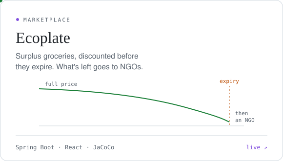</picture></a>
&nbsp;
<a href="https://livesentimentaura.vercel.app"><picture><source media="(prefers-color-scheme: dark)" srcset="./assets/card-aura-dark.svg">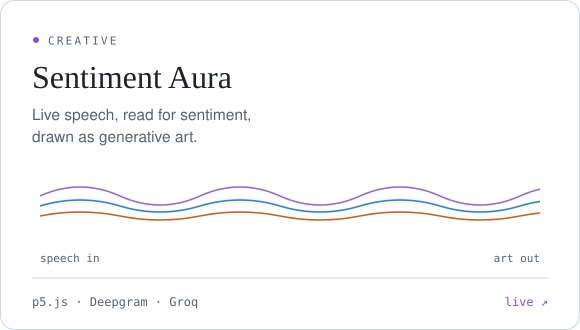</picture></a>

<i>The demos run on free tiers and nap when idle. Give the first request about 50 seconds.</i>

 

<picture><source media="(prefers-color-scheme: dark)" srcset="./assets/section-built-dark.svg"></picture>

<a href="https://github.com/K-sau07/tf-aws-infrastructure"><picture><source media="(prefers-color-scheme: dark)" srcset="./assets/mini-infra-dark.svg">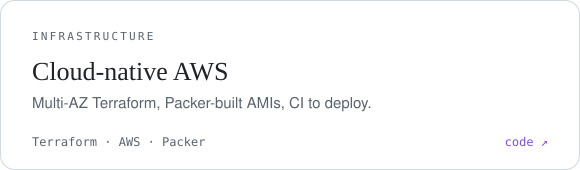</picture></a>
&nbsp;
<a href="https://github.com/K-sau07/EV_CHARGING_SYSTEM"><picture><source media="(prefers-color-scheme: dark)" srcset="./assets/mini-ev-dark.svg">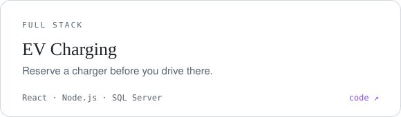</picture></a>

<a href="https://github.com/K-sau07/livermore-trading-bot"><picture><source media="(prefers-color-scheme: dark)" srcset="./assets/mini-livermore-dark.svg">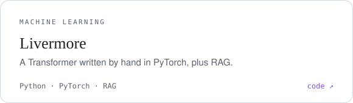</picture></a>
&nbsp;
<a href="https://github.com/K-sau07/Syncpoll"><picture><source media="(prefers-color-scheme: dark)" srcset="./assets/mini-syncpoll-dark.svg">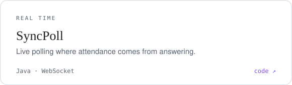</picture></a>

 

---

Java · Spring · Python · TypeScript · Postgres · AWS &nbsp;&nbsp;|&nbsp;&nbsp; [reposensei.com](https://reposensei.com) · [LinkedIn](https://www.linkedin.com/in/saurabh-kashyap-b5a4ab22a/) · [saurabh.k@itjobinbox.com](mailto:saurabh.k@itjobinbox.com) &nbsp;&nbsp;|&nbsp;&nbsp; Open to software engineering roles. Boston, happy to relocate.
